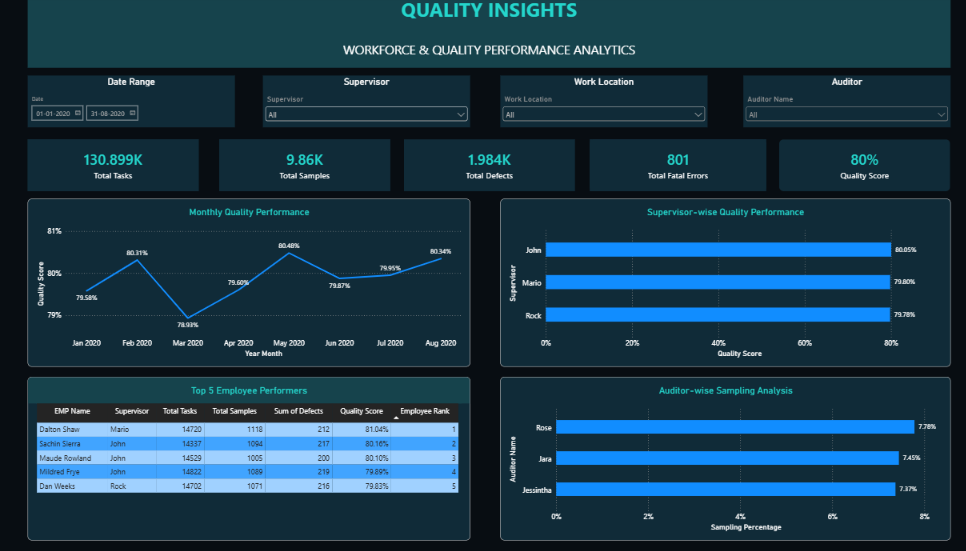
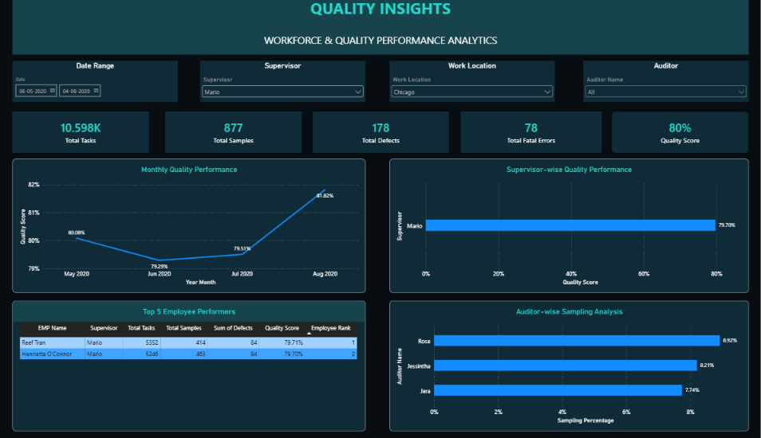

📊 Quality Insights Dashboard
Overview

The Quality Insights Dashboard provides a clear and interactive view of workforce performance and quality metrics. It helps track employee productivity, monitor quality scores, analyze defects, and evaluate supervisor and auditor performance.

Key Highlights - 
Tracks total tasks, samples, defects, fatal errors, and overall quality scores.
Analyzes monthly quality performance trends.
Compares quality scores across supervisors.
Identifies the top 5 employee performers.
Monitors auditor-wise sampling performance.
Provides interactive filters for better data analysis.

Objective -> The main goal of this project is to transform quality data into meaningful insights, identify performance gaps, reduce errors, and support better decision-making.

An interactive dashboard designed to make quality monitoring and performance analysis easier, faster, and more effective.

